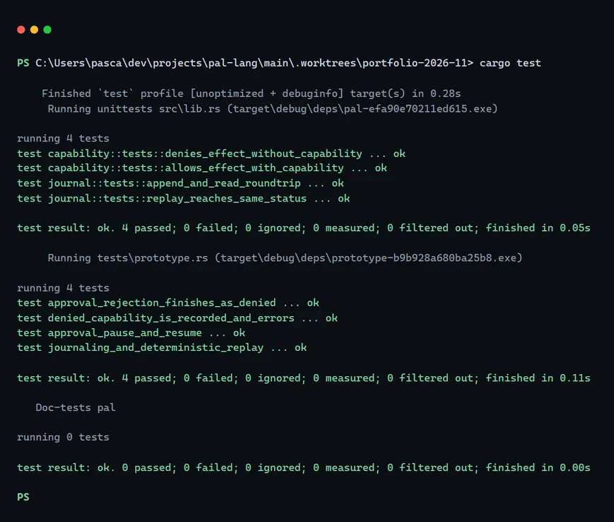

# PAL (prototype)



PAL is a small Rust sketch of a durable, capability-safe runtime for supervised AI agents. It is a bounded local prototype and the code here stops well short of a language release. The aim is to show the least machinery that still holds four runtime properties:

1. An append-only task journal, persisted as local JSONL (`Journal`).
2. A typed effect boundary, where each effect needs an explicit grant (`CapabilitySet` plus `Effect`).
3. Deterministic replay: the same journal rebuilds the same `TaskSnapshot`.
4. A human-approval pause. A task can sit in `AwaitingApproval`, survive a process restart through the journal, and continue with a recorded decision.

Nothing here makes a network call, holds credentials, or talks to a remote service.

## Quick start

```bash
cargo test
cargo fmt --check
```

Both run clean on Rust 1.95.0, Windows. `cargo test` reports 4 unit tests plus 4 integration tests, all passing.

## Layout

| Path | Role |
|------|------|
| `src/types.rs` | Task ids, status, journal events, snapshots |
| `src/journal.rs` | Append-only JSONL persistence and the replay fold |
| `src/capability.rs` | `Capability`, `Effect`, authorize gate |
| `src/runtime.rs` | Start, step, effect, approve, finish |
| `tests/prototype.rs` | Journaling and replay, denied capability, approval |

## Example flow

```rust
use pal::{ApprovalDecision, Capability, CapabilitySet, Journal, Runtime, TaskId};

let journal = Journal::open("pal.jsonl")?;
let caps = CapabilitySet::with([Capability::Log]);
let rt = Runtime::new(journal, caps);
let tid = TaskId::new("demo-1");

rt.start_task(tid.clone(), "demo")?;
rt.complete_step(&tid, "think", "planned work")?;
// Denied unless Capability::HttpFetch is granted:
// rt.attempt_effect(&tid, Effect::HttpFetch { url: "...".into() })?;
rt.request_approval(&tid, "ship the change")?;
rt.resume_with_approval(
    &tid,
    ApprovalDecision {
        approved: true,
        note: "lgtm".into(),
    },
)?;
rt.finish(&tid, "done")?;
let snap = rt.replay(&tid)?;
```

The snippet is the shape of the API, not a compiled example. `tests/prototype.rs` is the runnable version.

## Design notes

- Effects are stubs. An allowed effect is recorded and never executed against the OS or the network. `HttpFetch` never dials, `WriteLocal` never writes a file. That keeps the prototype offline.
- Capabilities are session-scoped. Grants live on `Runtime` construction. There is no policy language and no ACL hierarchy.
- The journal is JSONL, one event per line, with a best-effort `sync_all` after each append. SQLite would fit too; JSONL keeps the dependency list short.
- Replay is a pure fold. `TaskSnapshot::apply` is the only reducer, and it reads no wall clock and no RNG.
- Approval is a stub. Durable state transitions and a decision record exist. No UI, no multi-party workflow.

## Limitations

Out of scope on purpose:

- No language surface: no parser, no AST, no interpreter. Only the runtime kernel.
- No multi-agent scheduling, timers, or consensus.
- No cryptographic integrity or signed journals.
- No concurrent writers. The design assumes one process.
- No real I/O adapters for filesystem, HTTP, or shell.
- No credential store, sandbox, or OS-level confinement.
- Not published to crates.io (`publish = false`).

## Tests

`cargo test` covers:

- journaling and an independent deterministic replay
- a denied capability (`HttpFetch` without the grant)
- an approval pause that blocks progress, then resumes the same task
- an approval rejection that finishes the task as `Denied`

## License

MIT, as declared in `Cargo.toml`. The repository has no `LICENSE` file yet.
